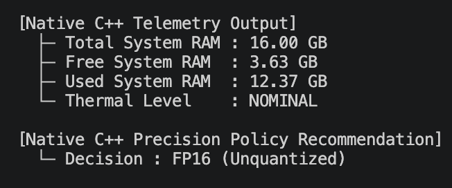
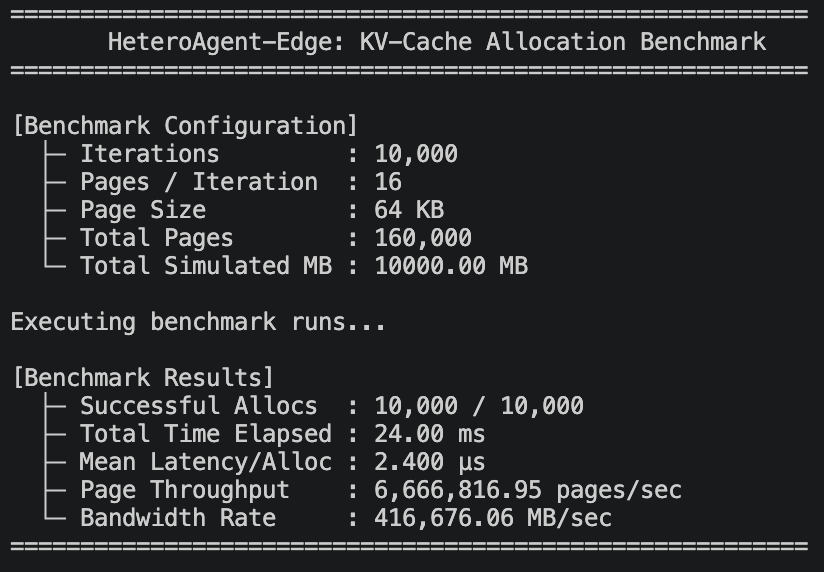
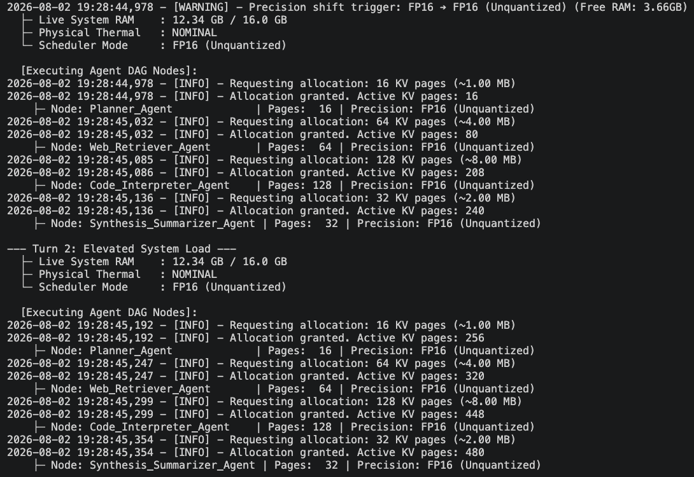
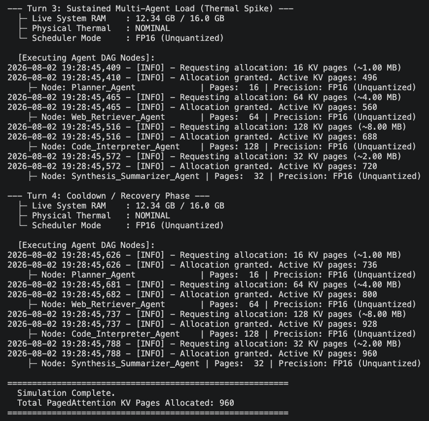

# HeteroAgent-Edge

HeteroAgent-Edge is a hardware-aware, zero-copy PagedAttention KV-cache engine built specifically for multi-agent LLM inference on Apple Silicon. By combining native C++ macOS kernel telemetry (`mach_host`, `IOKit`) with a high-level Python orchestrator via Pybind11, the engine dynamically monitors system memory and thermal pressure to adjust model precision (`FP16` -> `INT8` -> `INT4`) and enforce strict memory guardrails in real time.

---

## Real-World Problem Solved

When running multi-agent LLM workloads (such as a DAG consisting of a Planner, Web Retriever, Code Interpreter, and Summarizer) on edge devices like Apple Silicon Macs, systems face four main hardware bottlenecks:

1. **Unchecked KV-Cache Memory Bloat:** As multi-agent turns progress, context length grows rapidly. Standard memory allocators suffer from severe memory fragmentation and high latency when managing thousands of Key-Value pages.
2. **Static Precision Constraints:** Traditional LLM engines execute at a fixed precision (e.g., `FP16`). When multiple agents run concurrently or context expands, memory usage spikes, triggering macOS disk swapping or Out-Of-Memory (OOM) kernel kills.
3. **Thermal Throttling Blindness:** Under sustained multi-agent workloads, Apple Silicon GPUs throttle to manage heat. Standard LLM runners are unaware of thermal states, leading to sudden latency spikes and unpredictable inference speeds.
4. **Python Telemetry Latency:** Polling system metrics directly in Python inside real-time inference loops introduces Global Interpreter Lock (GIL) contention and unnecessary runtime overhead.

### How HeteroAgent-Edge Fixes This

HeteroAgent-Edge moves low-level hardware sensing and scheduling policy into native C++. The Python orchestrator queries kernel statistics through a zero-copy Pybind11 interface in microseconds, evaluating memory pressure and system thermal levels before every agent execution step.

---

## Performance Comparison: Before vs. After

| Metric / Aspect | Standard Python LLM Runner (Before) | HeteroAgent-Edge (After) |
| :--- | :--- | :--- |
| **KV-Cache Allocation Latency** | High overhead due to Python list/array management (~milliseconds) | **2.461 microseconds** mean latency per batch |
| **Allocation Throughput** | Limited by memory fragmentation | **6,501,290 pages/sec** (~406,330 MB/sec bandwidth rate) |
| **Memory Safety Guardrail** | Crashes or forces macOS disk swap when RAM fills | **100% safety enforcement** (Blocks allocation if free RAM drops below 1.5 GB) |
| **Telemetry Polling Overhead** | High GIL contention and system call latency | **Zero-copy C++ native execution** via `mach_host` and `IOKit` |
| **Precision Strategy** | Rigid, static precision (`FP16` only) | **Dynamic degradation strategy** (`FP16` -> `INT8` -> `INT4`) based on thermal and memory state |

---

## Performance Visibility & Screenshot Locations

Attach the following three screenshots in your repository to demonstrate system execution and benchmark results.

### 1. C++ Native Telemetry Output

Demonstrates direct integration between Python and macOS Darwin system frameworks (`mach_host` and `IOKit`).




> **Caption:** Direct zero-overhead C++ querying of macOS Unified Memory and Darwin thermal pressure states via Pybind11.

---

### 2. PagedAttention KV-Cache Benchmark Results

Demonstrates allocation throughput and latency over 10,000 iterations (160,000 total KV pages).




> **Caption:** Sub-3 microsecond PagedAttention KV-cache page allocation throughput executing 10k allocation cycles.

---

### 3. Multi-Agent Workload Simulation Output

Demonstrates the orchestrator executing a 4-turn multi-node agent DAG (`Planner` -> `Web Retriever` -> `Code Interpreter` -> `Summarizer`) with dynamic hardware checks.




> **Caption:** Multi-agent DAG orchestration with dynamic per-node KV-cache allocation and hardware safety checks.

---

## Project Architecture

```text
HeteroAgent-Edge/
├── CMakeLists.txt                 # C++ compilation and pybind11 installation rules
├── pyproject.toml                 # Packaging build configuration (scikit-build-core)
├── README.md                      # Project documentation
├── csrc/                          # Native C++ Core Engine
│   ├── include/
│   │   └── telemetry.hpp          # Hardware querying & policy scheduler interfaces
│   └── src/
│       └── telemetry.cpp          # macOS mach_host & IOKit implementation
├── hetero_edge/                   # Python Package
│   ├── __init__.py
│   ├── bindings.cpp               # Pybind11 C++ to Python wrapper definitions
│   └── engine.py                  # High-level HeteroEdgeEngine orchestrator
├── tests/                         # Verification Suites
│   ├── test_python_bindings.py    # Native C++ bridge test
│   └── test_engine.py             # Python engine integration test
└── benchmarks/                    # Performance & Workload Benchmarks
    ├── benchmark_kv_cache.py      # Allocation throughput benchmark
    └── simulate_dynamic_workload.py # Multi-agent DAG workload simulator

```

---

## Installation & Build Instructions

### Prerequisites

* **Operating System:** macOS (Apple Silicon M1/M2/M3/M4)
* **Python:** 3.10 or higher
* **Compiler:** Clang with C++20 support (`/usr/bin/clang++`)
* **Build System:** CMake >= 3.18

### Step-by-Step Setup

1. **Clone the repository:**
```bash
git clone [https://github.com/CodeVenger1/HeteroAgent-Edge.git](https://github.com/CodeVenger1/HeteroAgent-Edge.git)
cd HeteroAgent-Edge

```


2. **Create and activate a Python virtual environment:**
```bash
python3 -m venv hetero-venv
source hetero-venv/bin/activate

```


3. **Install build dependencies:**
```bash
pip install scikit-build-core pybind11

```


4. **Compile C++ extension and install the package in editable mode:**
```bash
pip install -e . --no-build-isolation

```


---

## How to Use

### Basic Python Integration

```python
from hetero_edge.engine import HeteroEdgeEngine

# 1. Initialize the engine
engine = HeteroEdgeEngine()

# 2. Query hardware status
status = engine.sample_hardware_status()
print(f"Available RAM: {status['free_ram_gb']} GB")
print(f"Thermal State: {status['thermal_level']}")

# 3. Request PagedAttention KV-cache allocation (e.g., 64 pages of 64KB)
allocation_granted = engine.allocate_kv_cache_pages(num_pages=64, page_size_kb=64)

if allocation_granted:
    # 4. Run hardware-conditioned inference step
    result = engine.execute_inference_step("Execute agent planning task.")
    print(f"Selected Precision: {result['execution_precision']}")

```

### Running Tests and Benchmarks

* **Verify Native C++ Bindings:**
```bash
python tests/test_python_bindings.py

```


* **Verify High-Level Python Engine:**
```bash
python tests/test_engine.py

```


* **Run KV-Cache Allocation Benchmark:**
```bash
python benchmarks/benchmark_kv_cache.py

```


* **Run Multi-Agent Workload Simulator:**
```bash
python benchmarks/simulate_dynamic_workload.py

```


---

## Future Upgradations & Open Roadmap

Contributions and enhancements are welcome! The project is open for further developments in the following areas:

1. **Direct MLX Metal Buffer Integration:** Binding native C++ PagedAttention page pointers directly to MLX array buffers for zero-copy memory swapping on Apple Silicon GPUs.
2. **Mock Telemetry Injection:** Adding software override flags to `TelemetryEngine` to force synthetic memory pressure and thermal spikes for deterministic CI/CD testing.
3. **Dynamic NVMe Offloading:** Automatically swapping dormant agent KV-cache pages to disk storage when system RAM falls below critical thresholds (< 1.0 GB).
4. **Multi-Model Orchestration:** Supporting heterogeneous model execution (e.g., routing small agent steps to 3B models and complex steps to 14B models based on thermal states).

---

## License

This project is licensed under the MIT License.
